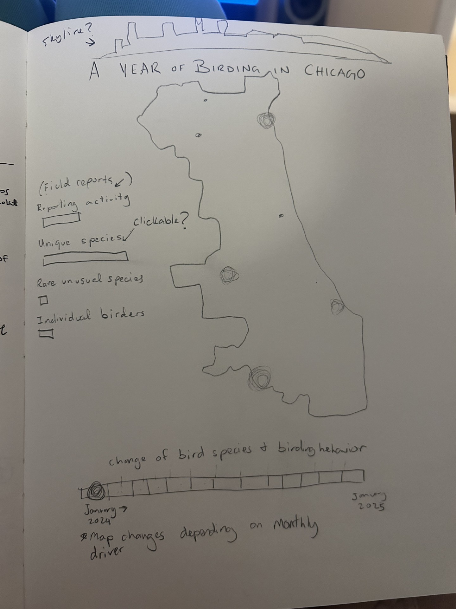

# Ciara Staveley-O'Carroll

## Description

For my interactive project, I want to build on *Chicago's Birders and Birds*, my static project using eBird records from 2020 to 2024. I was interested in where Chicagoans go birding, which species they report and how the people submitting observations shape the record.

This time, I want readers to move through a year of birding in Chicago. My idea is an animated map with a timeline from January through December 2024. As someone moves through the months, the map will change to show where people submitted birdwatching reports and which areas recorded more species. Readers will also be able to click a location to learn more about the birds reported there.

My goal is to make the seasonal and geographic patterns easier to explore, while keeping the distinction between birdwatching activity and the birds themselves clear.

## Technical Plan re: Option A

I plan to use **Option A: Large Interactive**, with one animated map as the main visualization. I want to use **D3.js** for the map, circles representing reporting locations and transitions between months. I will use **HTML and CSS** for the webpage and controls, and **Python with pandas and GeoPandas** to prepare the data.

The first version will focus on three interactions:

1. **Timeline:** Drag a slider or press Play to move through the months of 2024. The map will update as reporting activity changes.
2. **Map measure:** Switch between the number of submitted checklists and the number of distinct species reported. Circle sizes will change with the selected measure.
3. **Location details:** Click a circle to see the location's monthly reporting totals and some of the species recorded there.

My sketch also includes ideas for highlighting unusual sightings and individual birders. I would like to explore those if the main interaction is working well, but they are secondary to the timeline and map.

I will use a simplified map of Chicago and a small, prepared data file with monthly summaries by location. The map will show **reported observations**, rather than the actual movements or abundance of birds. I would like to keep the bird-inspired colors and simple visual style from my static project.

Two pieces I am drawing inspiration from are:

- [Google Public Data Explorer](https://www.google.com/publicdata/explore), for the ability to change the time period and measure while exploring the same dataset.
- [How Much Hotter Is Your Hometown? — The New York Times](https://www.nytimes.com/interactive/2018/08/30/climate/how-much-hotter-is-your-hometown.html), for making changes over time understandable through interaction.

## Mockup
THIS IS VERY CRUDE AND SUBJECT TO CHANGE

My sketch shows the Chicago map in the center, a set of choices for what the map displays on the left and a timeline along the bottom. The circles represent locations where people submitted birdwatching reports for that month. Moving the timeline will update the circles/networks across the city, while clicking a location will show more information about its records.

## Data Sources

### Data Source 1: eBird Basic Dataset

URL: https://science.ebird.org/en/use-ebird-data/download-ebird-data-products

Size: **218,781 unique Chicago checklists** in the 2020–2024 subset used for my static project. The original sampling-event data have **34 columns**; species observations are stored separately and include multiple records per checklist. I will create a smaller summary dataset for the interactive.

I used the August 2026 release for my static project. The data contain observation dates, locations, observer identifiers, species and checklist identifiers. For this project, I plan to summarize submitted checklists and distinct species by location and month, beginning with 2024.

### Data Source 2: City of Chicago Community Area Boundaries

URL: https://data.cityofchicago.org/d/igwz-8jzy

Size: **77 geographic records**. A published spatial read shows **9 attribute fields**, excluding geometry; the number of fields may differ in the GeoJSON export I use.

I used this dataset to map birdwatching activity in my static project. I plan to use it for the outline and geographic context of the interactive map.

## Questions

1. Would an animated D3 map with a month slider, a measure selector and clickable locations meet the expectations for Option A, or should I classify it as Option C because it is geographic?
2. Are there updated 2026 requirements or hosting details I should plan for?